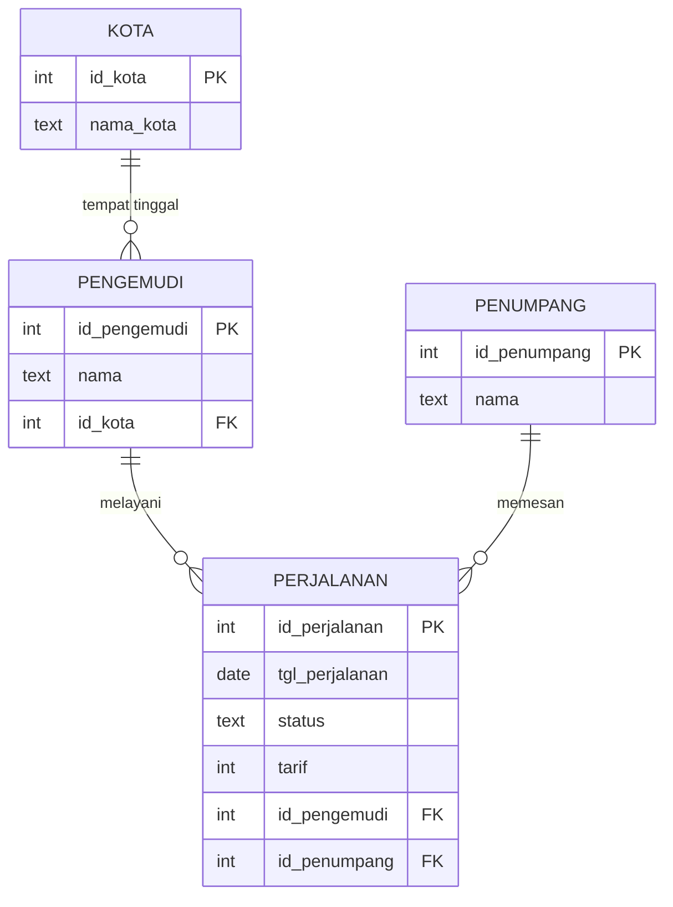

# Dokumentasi Tugas Optimasi Basis Data
## Studi Kasus: Aplikasi Ojek Online

| Item | Keterangan |
|---|---|
| Mata kuliah | Optimasi dan Teknologi Basis Data (25065105) |
| Materi | M03 Normalisasi vs Denormalisasi, menerapkan M01 (Execution Plan) dan M02 (Strategi Pengindeksan Lanjut) |
| DBMS | PostgreSQL 18 |
| Database | `ojek` |
| Port | 8001 |
| Penyusun | [Farrel Rizna Afrizal, 06.2024.1.07789] [Aulia Cindi Mareta, 06.2024.1.07824] [Norman Dwi Sulistiawan, 06.2024.1.07807] |
| Tanggal pengerjaan | [17/10/2026] |


> **Cara memakai dokumen ini.** Bagian rancangan, skrip, dan daftar query sudah lengkap. Bagian bertanda **[isi]** adalah hasil pengukuran milikmu sendiri, dan harus diisi setelah kamu menjalankan `EXPLAIN ANALYZE`. Jangan mengisinya dengan angka dari contoh lain.

---

## 1. Pendahuluan

### 1.1 Tujuan

1. Merancang basis data yang sudah dinormalisasi hingga bentuk normal ketiga (3NF).
2. Membangun dataset dengan satu tabel berisi minimal 5 juta baris.
3. Menyusun minimal 3 query, lalu mengukur dan memperbaiki kinerjanya dengan indeks, penulisan ulang query, dan denormalisasi terbatas.
4. Memutuskan strategi desain (normalisasi, denormalisasi, atau campuran) berdasarkan data pengukuran, bukan perkiraan.

### 1.2 Alur kerja

Alur ini mengikuti pesan kunci Materi 03:

```
1. Normalisasi dulu (rancang tabel sampai 3NF)
2. Ukur kinerja (EXPLAIN ANALYZE, catat waktu)
3. Coba cara lain (tambah indeks atau tulis ulang query)
4. Denormalisasi terbatas (hanya bagian yang lambat dan sering dibaca)
```

Untuk setiap query, siklusnya: **Ukur → Temukan bagian paling lambat → Perbaiki satu hal → Ukur ulang.**

---

## 2. Studi Kasus

Sebuah aplikasi ojek online mencatat setiap perjalanan yang terjadi: siapa pengemudinya, siapa penumpangnya, kapan, berapa tarifnya, dan apakah perjalanan itu selesai atau dibatalkan. Data perjalanan tumbuh sangat cepat hingga jutaan baris.

Kebutuhan yang dilayani:

| Kebutuhan | Sifat | Contoh |
|---|---|---|
| Penumpang melihat riwayat perjalanannya | Sering dibuka, harus cepat | Halaman "Riwayat Perjalanan" |
| Tim operasional memantau pembatalan | Dibuka berkala, hanya sebagian kecil data | Daftar perjalanan dibatalkan |
| Direksi melihat laporan pendapatan per kota | Berat (menggabungkan banyak tabel), jarang berubah | Laporan bulanan |

---

## 3. Perancangan Basis Data

### 3.1 Data mentah (sebelum normalisasi)

Bentuk paling sederhana adalah menyimpan semuanya dalam satu tabel:

| id_perjalanan | tgl | status | tarif | nama_pengemudi | kota_pengemudi | nama_penumpang |
|---|---|---|---|---|---|---|
| 1 | 2025-01-05 | selesai | 15.000 | Andi | Surabaya | Rina |
| 2 | 2025-01-06 | selesai | 22.000 | Andi | Surabaya | Agus |
| 3 | 2025-01-09 | dibatalkan | 18.000 | Andi | Surabaya | Rina |

Masalahnya, nama dan kota pengemudi serta nama penumpang diulang di setiap baris perjalanan. Ini memunculkan tiga anomali:

| Anomali | Contoh pada kasus ini |
|---|---|
| Ubah | Andi pindah ke Malang. Kota Andi harus diubah di ribuan baris, dan satu baris yang terlewat membuat Andi tercatat di dua kota |
| Hapus | Menghapus satu-satunya perjalanan seorang pengemudi ikut menghilangkan data pengemudi itu |
| Tambah | Pengemudi baru tidak bisa dicatat sebelum ia menyelesaikan perjalanan pertamanya |

### 3.2 Proses normalisasi

**1NF (satu sel, satu nilai).** Setiap sel pada tabel mentah sudah berisi satu nilai, jadi tabel sudah memenuhi 1NF.

**2NF (bergantung pada seluruh kunci utama).** Kunci utama tabel mentah hanya satu kolom (`id_perjalanan`), sehingga tidak mungkin ada ketergantungan pada *sebagian* kunci. Tabel otomatis memenuhi 2NF.

**3NF (kolom non-kunci tidak saling bergantung).** Ada ketergantungan antar kolom non-kunci:

| Ketergantungan | Penjelasan |
|---|---|
| `nama_pengemudi`, `kota_pengemudi` ditentukan oleh pengemudinya | Bukan oleh perjalanan tertentu |
| `nama_penumpang` ditentukan oleh penumpangnya | Bukan oleh perjalanan tertentu |

Perbaikan: pindahkan ke tabel `pengemudi` dan `penumpang`, lalu tabel `perjalanan` hanya menyimpan nomor (foreign key) keduanya. Tabel `kota` dipisah agar penulisan nama kota seragam (tidak ada salah ketik seperti "Surabya") dan agar sebuah kota dapat direferensikan oleh banyak pengemudi.

### 3.3 Skema akhir (3NF)



Relasi dalam teks biasa:

```
kota (1) ──── (N) pengemudi (1) ──── (N) perjalanan (N) ──── (1) penumpang
```

### 3.4 Kamus data

| Tabel | Kolom | Tipe | Keterangan |
|---|---|---|---|
| `kota` | `id_kota` | INT, PK | Nomor kota |
| | `nama_kota` | TEXT | Nama kota |
| `pengemudi` | `id_pengemudi` | INT, PK | Nomor pengemudi |
| | `nama` | TEXT | Nama pengemudi |
| | `id_kota` | INT, FK | Kota tempat pengemudi beroperasi |
| `penumpang` | `id_penumpang` | INT, PK | Nomor penumpang |
| | `nama` | TEXT | Nama penumpang |
| `perjalanan` | `id_perjalanan` | INT, PK | Nomor perjalanan |
| | `tgl_perjalanan` | DATE | Tanggal perjalanan |
| | `status` | TEXT | `selesai` atau `dibatalkan` |
| | `tarif` | INT | Tarif dalam rupiah |
| | `id_pengemudi` | INT, FK | Pengemudi yang melayani |
| | `id_penumpang` | INT, FK | Penumpang yang memesan |

---

## 4. Pembangunan Dataset

### 4.1 Membuat database dan memastikan posisi

Koneksi melalui psql dengan port 8001.

```sql
CREATE DATABASE ojek;
```

```
\c ojek
```

```sql
SELECT current_database();
```

Hasil harus `ojek`. Pengecekan ini dilakukan karena semua tabel akan dibuat di database tempat sesi berada.

### 4.2 Membuat tabel

```sql
CREATE TABLE kota (
    id_kota   INT PRIMARY KEY,
    nama_kota TEXT NOT NULL
);

CREATE TABLE pengemudi (
    id_pengemudi INT PRIMARY KEY,
    nama         TEXT NOT NULL,
    id_kota      INT  NOT NULL
);

CREATE TABLE penumpang (
    id_penumpang INT PRIMARY KEY,
    nama         TEXT NOT NULL
);

CREATE TABLE perjalanan (
    id_perjalanan  INT PRIMARY KEY,
    tgl_perjalanan DATE NOT NULL,
    status         TEXT NOT NULL,
    tarif          INT  NOT NULL,
    id_pengemudi   INT  NOT NULL,
    id_penumpang   INT  NOT NULL
);
```

### 4.3 Mengisi data

Urutan pengisian: tabel kecil dahulu, karena `perjalanan` merujuk ke `pengemudi` dan `penumpang`.

```sql
INSERT INTO kota VALUES
 (1,'Surabaya'),(2,'Malang'),(3,'Sidoarjo'),(4,'Gresik'),(5,'Kediri'),
 (6,'Jember'),(7,'Madiun'),(8,'Mojokerto'),(9,'Pasuruan'),(10,'Blitar');

INSERT INTO pengemudi
SELECT i, 'Pengemudi ' || i, 1 + (i % 10)
FROM generate_series(1, 5000) AS i;

INSERT INTO penumpang
SELECT i, 'Penumpang ' || i
FROM generate_series(1, 100000) AS i;

INSERT INTO perjalanan
SELECT i,
       DATE '2025-01-01' + (random() * 364)::int,
       CASE WHEN random() < 0.03 THEN 'dibatalkan' ELSE 'selesai' END,
       (5 + (random() * 45)::int) * 1000,
       1 + (random() * 4999)::int,
       1 + (random() * 99999)::int
FROM generate_series(1, 5000000) AS i;
```

Sebaran data yang dihasilkan:

| Kolom | Sebaran | Alasan |
|---|---|---|
| `tgl_perjalanan` | Acak sepanjang tahun 2025 | Agar filter rentang tanggal punya selektivitas yang realistis |
| `status` | Sekitar 3% `dibatalkan`, sisanya `selesai` | Proporsi kecil membuat eksperimen partial index bermakna |
| `tarif` | Rp5.000 sampai Rp50.000 (kelipatan Rp1.000) | Rentang tarif wajar |
| `id_pengemudi` | Acak dari 5.000 pengemudi (rata-rata ±1.000 perjalanan per pengemudi) | Pola baca per pengemudi |
| `id_penumpang` | Acak dari 100.000 penumpang (rata-rata ±50 perjalanan per penumpang) | Pola baca per penumpang |

### 4.4 Memasang foreign key dan memperbarui statistik

```sql
ALTER TABLE pengemudi  ADD FOREIGN KEY (id_kota)      REFERENCES kota (id_kota);
ALTER TABLE perjalanan ADD FOREIGN KEY (id_pengemudi) REFERENCES pengemudi (id_pengemudi);
ALTER TABLE perjalanan ADD FOREIGN KEY (id_penumpang) REFERENCES penumpang (id_penumpang);

ANALYZE;
```

Foreign key dipasang setelah data terisi karena memeriksa seluruh baris sekali di akhir lebih ringan daripada memeriksa tiap baris saat memasukkan jutaan data. `ANALYZE` memperbarui statistik agar optimizer memilih rencana eksekusi dengan perkiraan yang benar. Perlu dicatat bahwa PostgreSQL **tidak** otomatis membuat indeks pada kolom foreign key, sehingga `perjalanan.id_pengemudi` dan `perjalanan.id_penumpang` belum terindeks pada tahap ini.

### 4.5 Verifikasi

```sql
SELECT 'kota' AS tabel, count(*) FROM kota
UNION ALL SELECT 'pengemudi', count(*) FROM pengemudi
UNION ALL SELECT 'penumpang', count(*) FROM penumpang
UNION ALL SELECT 'perjalanan', count(*) FROM perjalanan;

SELECT pg_size_pretty(pg_total_relation_size('perjalanan')) AS ukuran_perjalanan;
```

| Tabel | Target jumlah baris | Hasil verifikasi |
|---|---|---|
| `kota` | 10 | [isi] |
| `pengemudi` | 5.000 | [isi] |
| `penumpang` | 100.000 | [isi] |
| `perjalanan` | 5.000.000 | [isi] |
| Ukuran `perjalanan` | - | [isi] |

---

## 5. Pengujian Query

### 5.1 Metode

- Setiap query dijalankan dengan `EXPLAIN ANALYZE` (query benar-benar dieksekusi, sehingga waktu yang dicatat adalah waktu nyata).
- Setiap pengukuran dijalankan 2-3 kali, lalu dicatat angka yang sudah stabil. Pengukuran pertama biasanya lebih lambat karena data belum berada di cache memori.
- Pengukuran **baseline** (sebelum perbaikan) dilakukan untuk semua query lebih dulu, baru indeks dibuat satu per satu.
- Setiap langkah perbaikan hanya mengubah **satu hal**, agar sebab dan akibat bisa dipisahkan.
- Cara membaca hasil: jenis scan, `cost` (satuan relatif, bukan milidetik), `Rows Removed by Filter`, jumlah blok pada `Buffers`, dan `Execution Time` (milidetik).

### 5.2 Ringkasan query

| # | Kebutuhan | Konsep | Materi |
|---|---|---|---|
| Q1 | Riwayat 10 perjalanan terakhir seorang penumpang | Indeks komposit, urutan kolom | M01, M02 |
| Q2 | Perjalanan dibatalkan sejak 1 Oktober 2025 | Partial index | M02 |
| Q3 | Laporan pendapatan per kota, Maret 2025 | Biaya JOIN, denormalisasi (tabel ringkasan) | M03, M01 |
| Q4 *(opsional)* | Total pendapatan seorang pengemudi | Covering index, Index Only Scan | M02 |
| Q5 *(opsional)* | Cari penumpang tanpa peduli huruf besar/kecil | Kolom dibungkus fungsi, indeks ekspresi | M01 |

---

### Q1: Riwayat perjalanan seorang penumpang

**Tujuan.** Menampilkan 10 perjalanan terbaru milik satu penumpang, seperti halaman "Riwayat Perjalanan".

```sql
EXPLAIN ANALYZE
SELECT id_perjalanan, tgl_perjalanan, tarif
FROM perjalanan
WHERE id_penumpang = 4021
ORDER BY tgl_perjalanan DESC
LIMIT 10;
```

**Hipotesis.** Tanpa indeks pada `id_penumpang`, database membaca seluruh tabel (Seq Scan) untuk menemukan sekitar 50 perjalanan milik penumpang itu, lalu mengurutkannya.

**Perbaikan.**

```sql
CREATE INDEX idx_perjalanan_penumpang_tgl
ON perjalanan (id_penumpang, tgl_perjalanan);

ANALYZE perjalanan;
```

Alasan susunan kolom: `id_penumpang` (kondisi `=`) di kiri agar baris satu penumpang berkumpul, dan `tgl_perjalanan` di kanan agar baris di dalam kelompok itu sudah terurut sehingga langkah pengurutan (Sort) tidak diperlukan.

| Metrik | Sebelum | Sesudah |
|---|---|---|
| Jenis scan | [isi] | [isi] |
| Cost | [isi] | [isi] |
| Rows Removed by Filter | [isi] | [isi] |
| Ada node Sort? | [isi] | [isi] |
| Execution Time (ms) | [isi] | [isi] |
| Ukuran indeks | - | [isi] |

**Analisis.** [isi: jelaskan perubahan jenis scan, hilangnya node Sort, dan selisih waktunya]

---

### Q2: Perjalanan yang dibatalkan

**Tujuan.** Memantau perjalanan yang dibatalkan sejak 1 Oktober 2025.

```sql
EXPLAIN ANALYZE
SELECT id_perjalanan, id_pengemudi, tgl_perjalanan
FROM perjalanan
WHERE status = 'dibatalkan' AND tgl_perjalanan >= '2025-10-01'
ORDER BY tgl_perjalanan;
```

**Hipotesis.** Hanya sekitar 3% baris yang berstatus `dibatalkan`, sehingga indeks yang hanya mencakup baris tersebut akan jauh lebih kecil daripada indeks penuh, dengan kecepatan baca yang setara.

**Perbaikan.**

```sql
CREATE INDEX idx_perjalanan_batal
ON perjalanan (tgl_perjalanan)
WHERE status = 'dibatalkan';

ANALYZE perjalanan;
```

Syarat pemakaian: kondisi `status = 'dibatalkan'` harus muncul di query, jika tidak indeks parsial tidak dapat dipakai.

**Pembanding ukuran** (indeks penuh dibuat sementara, lalu dihapus):

```sql
CREATE INDEX idx_uji ON perjalanan (status, tgl_perjalanan);

SELECT pg_size_pretty(pg_relation_size('idx_perjalanan_batal')) AS indeks_parsial,
       pg_size_pretty(pg_relation_size('idx_uji'))              AS indeks_penuh;

DROP INDEX idx_uji;
```

| Metrik | Sebelum | Sesudah |
|---|---|---|
| Jenis scan | [isi] | [isi] |
| Cost | [isi] | [isi] |
| Execution Time (ms) | [isi] | [isi] |
| Ukuran indeks parsial | - | [isi] |
| Ukuran indeks penuh (pembanding) | - | [isi] |

**Analisis.** [isi: bandingkan ukuran kedua indeks dan jelaskan mengapa indeks parsial lebih hemat]

---

### Q3: Laporan pendapatan per kota

**Tujuan.** Laporan untuk direksi: total pendapatan dari perjalanan yang selesai, per kota, pada bulan Maret 2025. Query ini harus menggabungkan 3 tabel.

```sql
EXPLAIN ANALYZE
SELECT k.nama_kota, SUM(p.tarif) AS total_pendapatan
FROM perjalanan p
JOIN pengemudi d ON d.id_pengemudi = p.id_pengemudi
JOIN kota k      ON k.id_kota      = d.id_kota
WHERE p.tgl_perjalanan >= '2025-03-01'
  AND p.tgl_perjalanan <  '2025-04-01'
  AND p.status = 'selesai'
GROUP BY k.nama_kota
ORDER BY total_pendapatan DESC;
```

**Hipotesis.** Query ini membaca ratusan ribu baris dari tabel `perjalanan` lalu menggabungkannya dengan dua tabel lain, sehingga menjadi query terberat di antara semuanya.

**Langkah perbaikan (berurutan, sesuai alur Materi 03).**

*Langkah 1: ukur baseline, lalu temukan node dengan waktu terbesar.*

*Langkah 2: coba indeks dulu.*

```sql
CREATE INDEX idx_perjalanan_tgl ON perjalanan (tgl_perjalanan);
ANALYZE perjalanan;
```

*Langkah 3: denormalisasi terbatas (tabel ringkasan), hanya jika langkah 2 belum cukup dan laporan ini sering dibuka.*

```sql
CREATE TABLE ringkasan_bulanan AS
SELECT date_trunc('month', p.tgl_perjalanan)::date AS bulan,
       k.nama_kota,
       COUNT(*)     AS jumlah_perjalanan,
       SUM(p.tarif) AS total_pendapatan
FROM perjalanan p
JOIN pengemudi d ON d.id_pengemudi = p.id_pengemudi
JOIN kota k      ON k.id_kota      = d.id_kota
WHERE p.status = 'selesai'
GROUP BY 1, 2;

EXPLAIN ANALYZE
SELECT nama_kota, total_pendapatan
FROM ringkasan_bulanan
WHERE bulan = '2025-03-01'
ORDER BY total_pendapatan DESC;
```

| Metrik | Baseline (3 tabel) | Setelah indeks tanggal | Tabel ringkasan |
|---|---|---|---|
| Jenis scan pada `perjalanan` | [isi] | [isi] | tidak membaca `perjalanan` |
| Jumlah tabel yang dibaca | 3 | 3 | 1 |
| Cost | [isi] | [isi] | [isi] |
| Execution Time (ms) | [isi] | [isi] | [isi] |
| Jumlah baris `ringkasan_bulanan` | - | - | [isi] |
| Ukuran tabel ringkasan | - | - | [isi] |

**Analisis.** [isi: node paling lambat pada baseline, pengaruh indeks tanggal, dan perbandingan dengan tabel ringkasan]

**Risiko denormalisasi.** Tabel ringkasan tidak ikut berubah ketika ada perjalanan baru, sehingga isinya bisa tertinggal dari data asli. Cara menjaga sinkronisasi yang dipertimbangkan: [isi: pilih salah satu atau lebih dari: proses terjadwal (batch), materialized view dengan `REFRESH`, trigger, transaksi di aplikasi, lalu jelaskan alasan pilihanmu].

---

### Q4 (opsional): Total pendapatan seorang pengemudi

```sql
EXPLAIN ANALYZE
SELECT SUM(tarif) FROM perjalanan WHERE id_pengemudi = 777;
```

**Hipotesis.** Primary key hanya membantu pencarian lewat `id_perjalanan`, sehingga pencarian berdasarkan `id_pengemudi` membaca seluruh tabel.

**Perbaikan.**

```sql
CREATE INDEX idx_perjalanan_cover
ON perjalanan (id_pengemudi) INCLUDE (tarif);

VACUUM ANALYZE perjalanan;
```

`INCLUDE (tarif)` menyimpan `tarif` di dalam indeks sehingga database tidak perlu membuka tabel (Index Only Scan). `VACUUM` membantu agar `Heap Fetches` mendekati nol.

| Metrik | Sebelum | Sesudah |
|---|---|---|
| Jenis scan | [isi] | [isi] |
| Heap Fetches | - | [isi] |
| Blok yang dibaca (Buffers) | [isi] | [isi] |
| Execution Time (ms) | [isi] | [isi] |
| Ukuran indeks | - | [isi] |

**Analisis.** [isi]

---

### Q5 (opsional): Cari penumpang tanpa peduli huruf besar/kecil

```sql
EXPLAIN ANALYZE
SELECT * FROM penumpang WHERE lower(nama) = 'penumpang 5000';
```

**Hipotesis.** Karena kolom `nama` dibungkus fungsi `lower()`, indeks biasa pada `nama` (jika ada) tidak dapat dipakai, sehingga database membaca seluruh tabel dan menghitung `lower()` untuk setiap baris.

**Perbaikan.**

```sql
CREATE INDEX idx_penumpang_nama_lower ON penumpang (lower(nama));
ANALYZE penumpang;
```

| Metrik | Sebelum | Sesudah |
|---|---|---|
| Jenis scan | [isi] | [isi] |
| Estimasi rows vs aktual | [isi] | [isi] |
| Execution Time (ms) | [isi] | [isi] |

**Analisis.** [isi]

---

### 5.3 Pengujian pelengkap: harga indeks

Indeks mempercepat baca tetapi memperlambat tulis. Pengukuran berikut dibungkus transaksi dan dibatalkan (`ROLLBACK`) agar dataset tidak berubah.

```sql
\timing on

BEGIN;
INSERT INTO perjalanan
SELECT i,
       DATE '2026-01-01' + (random() * 30)::int,
       'selesai',
       (5 + (random() * 45)::int) * 1000,
       1 + (random() * 4999)::int,
       1 + (random() * 99999)::int
FROM generate_series(5000001, 5100000) AS i;
ROLLBACK;
```

Jalankan satu kali **sebelum** indeks tambahan dibuat dan satu kali **sesudah** seluruh indeks terpasang, lalu bandingkan waktunya.

| Kondisi | Waktu insert 100.000 baris |
|---|---|
| Hanya primary key dan foreign key | [isi] |
| Setelah semua indeks tambahan terpasang | [isi] |

Daftar ukuran seluruh indeks (di psql: `\di+`):

| Indeks | Ukuran |
|---|---|
| `idx_perjalanan_penumpang_tgl` | [isi] |
| `idx_perjalanan_batal` | [isi] |
| `idx_perjalanan_tgl` | [isi] |
| `idx_perjalanan_cover` | [isi] |
| `idx_penumpang_nama_lower` | [isi] |

---

## 6. Pembahasan: Normalisasi atau Denormalisasi?

Tiga pertanyaan penentu dari Materi 03, diterapkan pada tabel `ringkasan_bulanan`:

| Pertanyaan | Jawaban untuk laporan pendapatan per kota |
|---|---|
| Seberapa sering data dibaca? | [isi: seberapa sering laporan dibuka] |
| Seberapa sering data diubah? | [isi: perjalanan baru terus masuk, tetapi laporan per bulan lampau tidak berubah] |
| Seberapa penting data selalu akurat? | [isi: apakah laporan boleh tertinggal beberapa jam atau hari] |

Perbandingan yang menjadi dasar pertimbangan:

| Aspek | Normalisasi (3 tabel) | Denormalisasi (tabel ringkasan) |
|---|---|---|
| Query baca | Perlu JOIN | Membaca satu tabel |
| Operasi tulis | Ringan | Ringkasan perlu diperbarui |
| Data berulang | Sedikit | Ada (nama kota disalin) |
| Konsistensi | Mudah dijaga | Harus dijaga |
| Cocok untuk | Transaksi (OLTP) | Laporan (OLAP) |

---

## 7. Keputusan Akhir

| Bagian | Keputusan | Alasan (berdasarkan data pengukuran) |
|---|---|---|
| Struktur tabel inti | Tetap dinormalisasi (3NF) | [isi] |
| Q1 | [isi: indeks komposit dipakai atau tidak] | [isi] |
| Q2 | [isi] | [isi] |
| Q3 | [isi: cukup indeks, atau perlu tabel ringkasan] | [isi] |
| Q4 | [isi] | [isi] |
| Q5 | [isi] | [isi] |

Pernyataan strategi akhir: [isi: normalisasi murni, denormalisasi, atau campuran, beserta 2 alasan dan 1 risiko]

---

## 8. Kesimpulan

1. Normalisasi sampai 3NF menjaga setiap fakta tersimpan di satu tempat, sehingga anomali ubah, hapus, dan tambah dapat dihindari. Harganya adalah bertambahnya JOIN pada query laporan.
2. Pengukuran dengan `EXPLAIN ANALYZE` menunjukkan bahwa [isi: ringkas temuan utama dengan angka dari pengujianmu].
3. Indeks mempercepat pembacaan tetapi menambah beban penulisan dan ruang penyimpanan, yang pada pengujian ini terukur sebesar [isi].
4. Denormalisasi (tabel ringkasan) [isi: dipakai atau tidak, dan mengapa], dengan risiko sinkronisasi data yang perlu dijaga.
5. Pelajaran utama: mulai dari normalisasi, ukur, coba indeks atau tulis ulang query, dan denormalisasi hanya jika terbukti perlu.

---

## Lampiran

### A. Daftar periksa pengerjaan

- [ ] Database `ojek` dibuat dan `current_database()` bernilai `ojek`
- [ ] Empat tabel dibuat dan terisi (perjalanan = 5.000.000 baris)
- [ ] Foreign key terpasang dan `ANALYZE` dijalankan
- [ ] Baseline Q1 sampai Q3 terukur (minimal 2 kali per query)
- [ ] Indeks dibuat satu per satu dan diukur ulang
- [ ] Tabel ringkasan dibuat dan diukur
- [ ] Pengujian harga indeks dan ukuran indeks tercatat
- [ ] Seluruh bagian **[isi]** pada dokumen ini sudah terisi dari hasil sendiri
- [ ] Keputusan akhir ditulis beserta alasan dan risiko

### B. Istilah

| Istilah | Arti singkat |
|---|---|
| Seq Scan | Membaca seluruh tabel dari awal sampai akhir |
| Index Scan | Mencari baris lewat struktur indeks (B-Tree) |
| Bitmap Scan | Mengumpulkan posisi baris dari indeks lebih dulu, lalu membaca tabel secara berurutan |
| Index Only Scan | Menjawab query hanya dari indeks, tanpa membuka tabel |
| Partial index | Indeks yang hanya mencakup baris yang memenuhi suatu syarat |
| Covering index | Indeks yang memuat semua kolom yang dibutuhkan query (`INCLUDE`) |
| Cost | Perkiraan biaya relatif dari optimizer, bukan milidetik |
| Denormalisasi | Sengaja menambah data berulang agar pembacaan lebih cepat |

### C. Referensi

- Silberschatz, A., Korth, H. F., & Sudarshan, S. (2019). *Database System Concepts* (7th ed.). McGraw-Hill.
- Connolly, T., & Begg, C. (2015). *Database Systems: A Practical Approach to Design, Implementation, and Management* (6th ed.). Pearson.
- Coronel, C., & Morris, S. (2023). *Database Systems: Design, Implementation, & Management* (14th ed.). Cengage.
- Elmasri, R., & Navathe, S. B. (2016). *Fundamentals of Database Systems* (7th ed.). Pearson.
- Winand, M. *SQL Performance Explained*.
- Dokumentasi PostgreSQL: *Using EXPLAIN*.
- Materi kuliah Optimasi dan Teknologi Basis Data, M01 sampai M03 (Nanang Fakhrur Rozi, ITATS).
